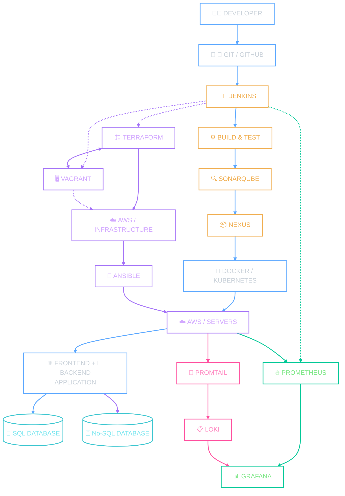

  
# **Hi there** 👋      
  
# BACKEND && DEVOPS ENGINEER   

**Java Backend Developer · CI/CD · Cloud · Automation**

[About Me](#-about-me) ·  [Projects](#-featured-projects) · [Workflow](#-my-workflow) · [Contact](#-connect-with-me)

## Welcome to My GitHub!

## Repo Down Here 👇👇👇  

---

## 👨‍💻 About Me

I'm a **DevOps Engineer and Java Backend Developer** passionate about building robust applications and reliable infrastructure.

- ☕ **Backend Development:** Java, Spring Boot, REST APIs, business logic, and database integration.
- 🔧 **DevOps & Automation:** Docker, Kubernetes, Jenkins, Terraform, Ansible, and CI/CD pipelines.
- ☁️ **Cloud & Infrastructure:** Cloud technologies, infrastructure automation, and reliable application deployments.
- 📊 **Monitoring & Reliability:** Application monitoring, logging, troubleshooting, and performance optimization.
- 🔄 **End-to-End Delivery:** Bridging development and operations—from writing backend code to deploying, monitoring, and scaling applications.

---

## 🚀 Featured Projects

<!-- PROJECT 1: Replace the image URL and repository link with your actual project details. -->

### 🌍 Wanderlust

**Full-Stack Application · Containerization · CI/CD**

A full-stack project focused on containerization and deployment automation.

**Technologies:** Docker · Jenkins · Nginx · CI/CD

- 🐳 Containerized application components.
- 🔄 Worked on CI/CD pipeline configuration.
- 🌐 Configured Nginx reverse proxy for application routing.
- 🛠️ Troubleshot deployment and infrastructure issues.

**[📂 View Repository](https://github.com/CodesBy-Bhuwan/wanderlust-DevOps)**

---

### ☁️ DevOps Infrastructure Project

**Infrastructure Automation · Cloud · Monitoring**

Infrastructure automation and deployment workflows using DevOps tools.

**Technologies:** AWS · Terraform · Ansible · Docker · Prometheus · Grafana

- 🏗️ Infrastructure provisioning and configuration automation.
- 🔄 CI/CD workflow implementation.
- 📊 System metrics monitoring and visualization.

**[📂 View Repository](https://github.com/CodesBy-Bhuwan/DevOps-Architecture)**

---

## 🔄 My Workflow

## 🚀 DevOps CI/CD Pipeline

### 🛠️ Technology Stack

- **Application:** Java, Spring Boot, React.js, REST APIs
- **Databases:** MySQL, SQLite
- **CI/CD:** Git, GitHub, Jenkins
- **Quality & Artifacts:** SonarQube, Nexus
- **Infrastructure:** Terraform, Ansible, Vagrant, AWS
- **Deployment:** Docker, Kubernetes
- **Monitoring:** Prometheus, Grafana
- **Logging:** Promtail, Loki

---

## 📅 Currently

- 🔨 **Working on:** CI/CD, containerization, and infrastructure projects.
- 📚 **Learning:** Kubernetes, Terraform, and cloud infrastructure.
- 🎯 **Goal:** Build reliable, secure, and scalable deployment workflows.

---

## 🤝 Connect With Me

*Building · Automating · Deploying*

 
